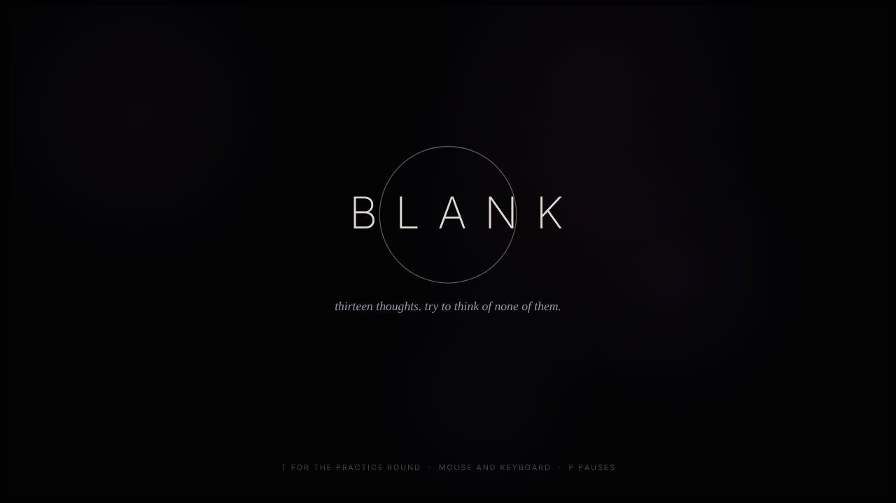
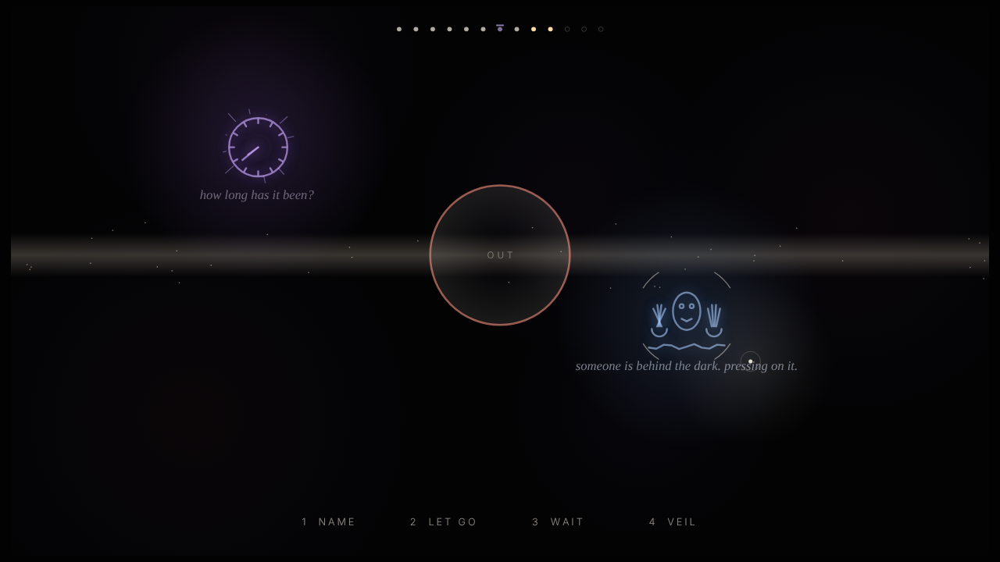

# Blank

Thirteen thoughts. Try to think of none of them.

The screen is the inside of your closed eyes. Keep it dark. Breathe with the ring, and when a thought drifts in, work out what kind it is and answer it before it grows.

**[Play it in your browser](https://mohib-ur-rehman-automation.github.io/blank/)** (enable GitHub Pages on this repo and it runs at `https://<your-username>.github.io/blank/`)

## How to play

The game opens with a short practice round that teaches each piece. In brief:

| Input | What it does |
| --- | --- |
| Hold mouse button or Space | Breathe in while the ring grows. Let go while it shrinks. Works anywhere on the screen. |
| Move the mouse | Your attention. The nearest thought is the one you answer. |
| 1 Name | For thoughts that shrink when you look at them. Keep the pointer on it. |
| 2 Let go | For thoughts that swell when you look at them. Move the pointer away first. |
| 3 Wait | For thoughts that feed on movement. Then hold the mouse still. |
| 4 Veil | Covers any thought at once. It comes back at the end. |
| P / M / T | Pause (with volume sliders) / mute / practice round from the title. |

- Losing the breath, leaving thoughts unanswered, or letting one grow full lets light in. Full light means your eyes open and the sitting ends.
- Every thought you cover or follow returns together at the end, with no curtain left.
- There is one quiet ending: all thirteen let go, nothing covered.
- The kinds are reshuffled every sitting, so there is nothing to memorise.

## About

One HTML file. No libraries, no images, no build step. Everything is drawn on a canvas and all sound is synthesized in the browser.

Concept and direction by Mohib Ur Rehman. Code written by Claude (Anthropic).

## License

MIT. See [LICENSE](LICENSE).
